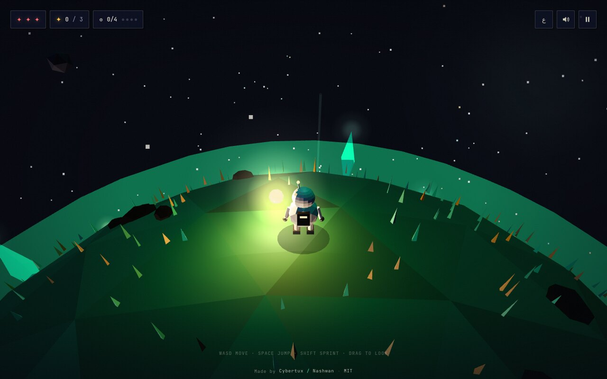

# Pocket Sun

**A tiny planet adventure.** Carry the last sun. Wake a sleeping world.

Pocket Sun is a handcrafted 3D micro-adventure that runs entirely in the browser.
You play the Sunkeeper: a small robot walking around a small planet, carrying a
small sun. Gather stardust, wake the beacons, bloom the dark side of the world,
and open the gate to the next planet.

Made by **[Cybertux / Nashwan](https://53536sg-alt.github.io/CyberTux-info/)**.



---

## Play

Once GitHub Pages is enabled, the game runs at:

`https://53536sg-alt.github.io/pocket-sun/`

No install. No build step. No backend. Just open the link.

### Controls

| Input | Action |
| --- | --- |
| `W A S D` / arrows | move around the planet |
| `Space` | jump (press again in mid-air for a sun-hop) |
| `Shift` | sprint |
| `E` / click | wake a beacon · step through the gate |
| Drag mouse | look around |
| Mouse wheel | zoom |
| `Esc` / `P` | pause |
| `M` | mute |

On phones and tablets: on-screen joystick, plus **JUMP** and **LIGHT** buttons.

### The loop

1. Land on a sleeping planet — the side facing away from the sun is dark.
2. Collect **stardust** floating above the surface.
3. Stand beside a **beacon** and press `E`. Three stardust wakes it, and the
   ground around it blooms.
4. **Gloom** creatures hunt in the dark. They are slower than you, but they are
   patient. Light makes them flee.
5. Wake every beacon. A gate opens. Follow the beam.

Five planets, five moods, one small sun.

---

## Why it looks the way it does

- **Low-poly, flat-shaded geometry** — the planet is an icosahedron whose faces
  are coloured by a hand-tuned noise function. No textures, no model packs.
- **A deliberately small palette** — deep navy, emerald, amber, cream, coral.
- **A real interface** — Space Grotesk + JetBrains Mono, hard 2px rules, offset
  shadows. Not a translucent glass panel in sight.
- **Sound made from scratch** — every pad, pluck and thunder is synthesised
  with the WebAudio API at runtime. There are zero audio files in this repo.
- **Details** — film grain, soft vignette, contact shadow, camera shake, squash
  and stretch, coyote time, a double jump with a little burst of sparks.

---

## Tech

- [Three.js](https://threejs.org/) r169, vendor-copied so the game works offline
- Vanilla ES modules — no bundler, no framework, no `node_modules`
- WebAudio for music and effects
- `localStorage` for language, mute and nothing else (no tracking, no cookies)
- Static files only — perfect for GitHub Pages

### Project layout

```
pocket-sun/
├── index.html            markup + all UI screens
├── css/style.css         the whole visual identity
├── js/
│   ├── main.js           state machine, loop, rules
│   ├── world.js          planets, beacons, dust, gloom, sky
│   ├── player.js         spherical gravity, movement, the Sunkeeper
│   ├── camera.js         spherical third-person rig
│   ├── input.js          keyboard, mouse, touch
│   ├── audio.js          procedural music + SFX
│   ├── fx.js             particles and shockwaves
│   ├── ui.js             screens, HUD, i18n, credits
│   ├── credits.js        developer data
│   └── utils.js          math, noise, glow textures
├── assets/
│   ├── logo.svg
│   ├── preview.jpg       README screenshot
│   └── og.jpg            social sharing card (1200×630)
├── vendor/three.module.js
├── LICENSE
└── README.md
```

### Run locally

Because the game uses ES modules, it needs a local web server (not `file://`):

```bash
cd pocket-sun
python3 -m http.server 8080
# then open http://localhost:8080
```

or:

```bash
npx serve .
```

### Debug shortcuts

- `?play=1` — skip the title screen and drop straight into the first planet
- `?play=1&level=3` — start on planet 4 (used for testing)

---

## Deploy to GitHub Pages

**Option A — GitHub Actions (recommended)**

1. Create a repository and push this folder to the `main` branch.
2. Go to **Settings → Pages → Build and deployment**.
3. Set **Source** to **GitHub Actions**.
4. The included workflow (`.github/workflows/pages.yml`) deploys on every push.

**Option B — branch folder**

1. Push the folder to `main`.
2. **Settings → Pages → Source: Deploy from a branch → `main` / `/ (root)`**.

The game is entirely static, so both work. Add a `.nojekyll` file (already
included) so files starting with `_` are served correctly.

---

## Credits

Designed, coded, drawn and scored by **Cybertux / Nashwan**.

- Info & CV: https://53536sg-alt.github.io/CyberTux-info/
- Telegram: https://t.me/v_u_y
- Instagram: https://www.instagram.com/q_rq56
- TikTok: https://www.tiktok.com/@6wz0

Built with [Three.js](https://threejs.org/) (MIT). The type is Space Grotesk
and JetBrains Mono via Google Fonts (SIL Open Font License).

If you remix this, keep the credit line and the link to the developer page.
That is all the license asks.

## License

MIT © 2026 Nashwan (Cybertux). See [LICENSE](LICENSE).
